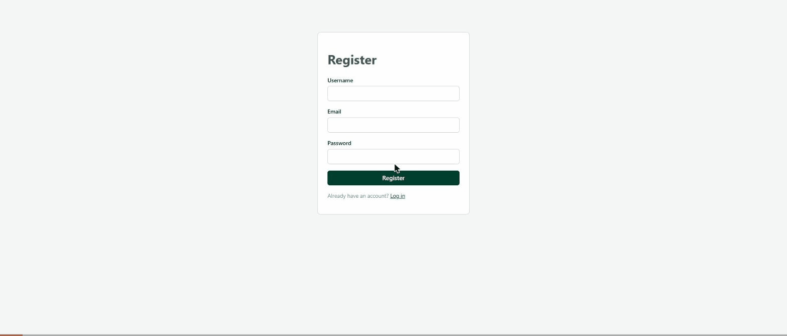

# Task List Application

A full-stack task management app: Angular frontend, ASP.NET Core Web API backend, PostgreSQL database. Users register/log in, then create, view, edit, and delete their own tasks (title, description, due date, priority, category, status).



## Tech stack

- **Frontend:** Angular 22 (standalone components, reactive forms, Angular Router)
- **Backend:** ASP.NET Core Web API (.NET 10)
- **Database:** PostgreSQL, accessed via Entity Framework Core

## Project structure

```
TaskListApplication/
├── backend/TaskListApi/   # ASP.NET Core Web API
├── frontend/               # Angular app
└── database/schema.sql     # Exported SQL schema (tables, indexes, functions)
```

## Setup & running locally

### Prerequisites

- [.NET 10 SDK](https://dotnet.microsoft.com/download)
- [Node.js](https://nodejs.org/) v22.22.3+ (or v24.15.0+/v26+) and npm — Angular 22 requires this; the build fails on Node 20 or 21
- [PostgreSQL](https://www.postgresql.org/download/) running locally on the default port (5432)

### 1. Database

Create the database:

```
createdb -U postgres tasklistdb
```

Apply migrations from the backend project (this creates all tables, indexes, and the two SQL functions used by the API):

```
cd backend/TaskListApi
dotnet ef database update
```

Alternatively, `database/schema.sql` contains the equivalent SQL and can be run directly against an empty database with `psql`.

`appsettings.Development.json` is gitignored since it holds the local connection string and JWT signing key. Copy the example file to create it:

```
cd backend/TaskListApi
cp appsettings.Development.example.json appsettings.Development.json
```

Update `ConnectionStrings:DefaultConnection` if your local Postgres uses a different username/password than `postgres` / `tasklistapplication`, and replace `Jwt:Key` with your own random string (at least 32 characters). In a real deployment these values would come from user secrets / environment variables / a secrets manager, never source control.

### 2. Backend

```
cd backend/TaskListApi
dotnet run
```

API runs at `http://localhost:5077`.

### 3. Frontend

```
cd frontend
npm install
npm start
```

App runs at `http://localhost:4200`.

Run both at the same time (two terminals) to use the app.

## Authentication

**Chosen mechanism: JWT (JSON Web Tokens), traditional username/email + password.**

Why JWT: the backend is a stateless REST API consumed by a separate Angular SPA, so a token-based approach avoids server-side session state and works naturally with `HttpClient` + an HTTP interceptor on the frontend. Passwords are hashed with ASP.NET Core Identity's `PasswordHasher` (PBKDF2) — plaintext passwords are never stored.

Flow:

- `POST /api/auth/register` and `POST /api/auth/login` return a signed JWT plus the user's basic info.
- The frontend stores the token in `localStorage` and an HTTP interceptor (`authInterceptor`) attaches it as `Authorization: Bearer <token>` on every outgoing API request. `localStorage` is readable by any script on the page, so it's vulnerable to XSS-based token theft; in production this would be an httpOnly, secure cookie instead, which JavaScript can't access at all.
- All task endpoints are decorated with `[Authorize]` — a request without a valid token is rejected with `401`.
- A functional Angular route guard (`authGuard`) blocks navigation to any task route unless a token is present, redirecting to `/login` otherwise. The same interceptor also catches a `401` response (e.g. an expired token) and redirects to `/login`.
- "Logout" simply clears the stored token client-side — since JWTs are stateless, there's no server-side session to invalidate.

SSO was not implemented in this version, but the schema was designed to support it — see below.

## Database schema

Two tables:

- **`Users`** — `Id` (uuid, PK), `Username`, `Email` (both unique), `PasswordHash` (nullable), `AuthProvider` (defaults to `"Local"`), `ProviderUserId` (nullable), `CreatedAt`.
- **`Tasks`** — `Id` (uuid, PK), `UserId` (FK → `Users.Id`, cascade delete), `Title`, `Description`, `DueDate`, `Priority` (enum: Low/Medium/High), `Category`, `Status` (enum: ToDo/InProgress/Completed, defaults to ToDo), `CreatedAt`, `UpdatedAt`.

**How SSO-vs-traditional users would be distinguished:** `PasswordHash` is nullable and `AuthProvider`/`ProviderUserId` already exist specifically so an SSO user (e.g. `AuthProvider = "Google"`, `ProviderUserId = <their Google subject id>`) could be stored with no password at all, alongside traditional users (`AuthProvider = "Local"`, a real `PasswordHash`, no `ProviderUserId`). No schema change would be needed to add SSO later.

**Stored functions** (Postgres functions called from the backend via EF Core's `FromSqlInterpolated`, used to fetch task data via a stored procedure/function):

- `get_tasks_by_user(p_user_id uuid)` — returns all tasks for a user, newest first.
- `get_task_by_id(p_id uuid, p_user_id uuid)` — returns a single task, scoped to its owner.

Full DDL (tables, indexes, constraints, functions) is in `database/schema.sql`.

## Accessing the app

There are no default/seeded accounts. Open `http://localhost:4200`, click **Register**, and create a new account (username, email, password — minimum 8 characters). You'll be logged in automatically and land on your (empty) task list.

## Future enhancements

- SSO (e.g. Google/Microsoft OAuth) — schema is already SSO-ready (see above); would add a new backend challenge/callback endpoint issuing the same JWT, and a frontend callback route, without touching existing login/guard/interceptor logic.
- Automated tests (backend controller/service tests, frontend component tests) — a natural next step.
